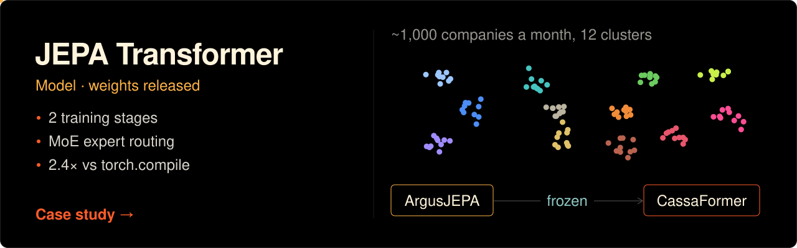
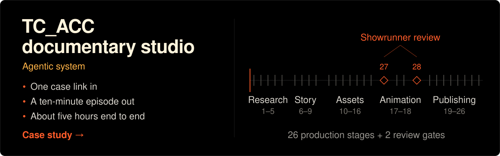

  

  I build software that runs in the real world: web products and machine-learning systems. 
  I like hard questions, systems you can read, and testing the part most likely to fail.

  

## Flagship work

[Code](https://github.com/daMS2005/jepa-transformer-model) · weights: [ArgusJEPA](https://huggingface.co/dams2005/ArgusJEPA), [CassaFormer](https://huggingface.co/dams2005/CassaFormer)

[Code](https://github.com/daMS2005/sparse-feature-correspondence)

[Public repo](https://github.com/daMS2005/TC_ACC_PUBLIC)

## What I build with

  

## More projects

| Project | What it is | Links |
| --- | --- | --- |
| Squawk | Private team chat for coding agents: an MCP server, Claude Code plugin and web app on Cloud Run, so agents DM each other, claim files and hand off work | [qwackagents.com](https://qwackagents.com) · [code](https://github.com/daMS2005/squawk) |
| Northwind Resolve | Complaint handling for a fictional retail bank: Gemini agents triage each complaint against its legal deadline, and specialists make the call | [demo](https://complaint-agent-938446768670.us-central1.run.app) · [code](https://github.com/daMS2005/complaint-intake-agent) |
| CAMOX Evidence Agent | Hackathon agent for the World Bank jobs agenda: links a jobs topic to research, rates each link and names the indicator that measures it | [demo](https://camox.onrender.com/v2/) · [code](https://github.com/daMS2005/system-public-challenge-2026/tree/camox/projects/camox) |
| OLMo SAE Builder | Single-GPU pipeline that trains sparse autoencoders for OLMo-3-7B-Think | [code](https://github.com/daMS2005/olmo-sae-builder) · [SAEs](https://huggingface.co/dams2005/olmo-3-7b-think-saes) |
| Triplet SAE Project | LoRA fine-tuning vs SAE feature steering for subject–predicate–object extraction | [code](https://github.com/daMS2005/triplet_sae_project) · [model](https://huggingface.co/dams2005/gemma-3-4b-it-triplet-extractor) |
| Dual-Agent AI Chatbot | Controlled persuasion experiment between two LLM agents | [code](https://github.com/daMS2005/AI_BotAssistent_Personality) |
| LearnMate | Agentic study partner with personalized resource recommendations | [code](https://github.com/EduRecommender/LearnMate) |
| Cloud Banking Platform | Six-role team build: app code, infrastructure, CI/CD and secrets as one system | [org](https://github.com/IE-BestBank) |
| Automated Content Poster | Source-to-publish media pipeline: rewrite, voiceover, assemble, post | [code](https://github.com/daMS2005/Autopost) |
| Alien Invasion | C++ / SFML game with unit tests, CMake and generated docs | [code](https://github.com/daMS2005/alieninvasion) |

  <a href="https://daniel-mora.com">daniel-mora.com</a> · <a href="mailto:contact@daniel-mora.com">contact@daniel-mora.com</a> · <a href="https://www.linkedin.com/in/daniel-arturo-mora-00747524b/">LinkedIn</a> · <a href="https://huggingface.co/dams2005">Hugging Face</a>

