I work across the ML stack: data pipelines, model training, GPU kernels, and the agent systems and services that run on top.

  

## What I work on

- **Model architecture and training:** self-supervised (JEPA) encoders, causal Transformers with RoPE and Mixture-of-Experts, LoRA fine-tuning, quantized exports
- **GPU performance:** custom Triton kernels, benchmarked against torch.compile and cuBLAS before they ship
- **Interpretability:** sparse autoencoders, activation capture, feature steering, ablation studies
- **Agent systems:** multi-stage pipelines with review gates and verifiers, MCP tool servers, RAG and GraphRAG
- **Production services:** APIs on Cloud Run, infrastructure as code, CI/CD

## Stack

<table>
<tr><td><b>Languages</b></td><td>   </td></tr>
<tr><td><b>ML</b></td><td>     </td></tr>
<tr><td><b>Agents and LLMs</b></td><td>     </td></tr>
<tr><td><b>Backend and data</b></td><td>    </td></tr>
<tr><td><b>Infra</b></td><td>   </td></tr>
<tr><td><b>Front end</b></td><td>    </td></tr>
</table>

## Repos worth a look

| Repo | What it is | Built with |
| --- | --- | --- |
| [jepa-transformer-model](https://github.com/daMS2005/jepa-transformer-model) | JEPA encoder + MoE Transformer, with Triton kernels up to 2.4× faster than torch.compile |    |
| [olmo-sae-builder](https://github.com/daMS2005/olmo-sae-builder) | Single-GPU pipeline that trains TopK SAEs on OLMo-3-7B-Think |    |
| [triplet_sae_project](https://github.com/daMS2005/triplet_sae_project) | SAE feature steering vs LoRA for structured extraction |   |
| [squawk](https://github.com/daMS2005/squawk) | MCP server and web app for coordinating coding agents |    |
| [TC_ACC_PUBLIC](https://github.com/daMS2005/TC_ACC_PUBLIC) | Excerpt of a 28-stage autonomous video pipeline |    |
